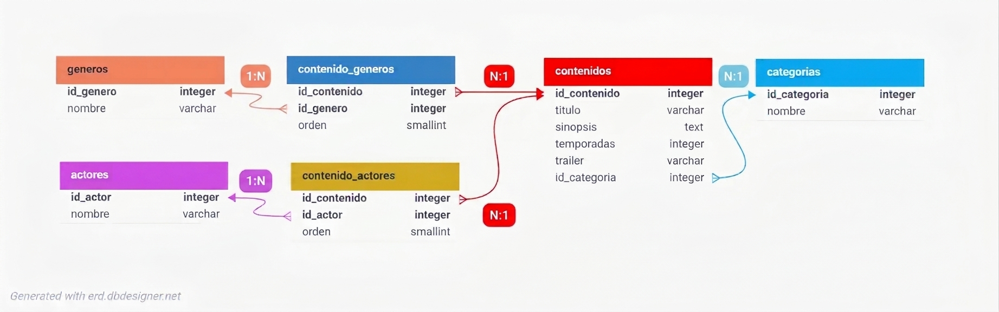

# Trailerflix - API REST con MySQL y Sequelize

Preentrega 3: API para consultar y administrar el catálogo de películas y
series Trailerflix. Usa un modelo relacional normalizado en seis tablas,
importación desde JSON y operaciones CRUD; está desarrollada con Node.js,
Express, Sequelize y MySQL.

## Sumario

- [Requisitos](#requisitos)
- [Configuración](#configuración)
- [Modelo de datos](#modelo-de-datos)
- [Importar los datos](#importar-los-datos)
- [Vista SQL](#vista-sql)
- [Iniciar la API](#iniciar-la-api)
- [Endpoints](#endpoints)
  - [Crear un contenido](#crear-un-contenido)
  - [Actualizar o eliminar](#actualizar-o-eliminar)
  - [Ejemplos de consulta](#ejemplos-de-consulta)

## Requisitos

- Node.js y npm
- MySQL en ejecución
- Ejecutar `trailerflix.sql` una sola vez sobre una base vacía para crear el
  esquema. No volver a ejecutar este archivo sobre una base ya preparada:
  también agrega las claves foráneas.

## Configuración

1. Instalar dependencias:

   ```sh
   npm install
   ```

2. Copiar `.env.example` como `.env` y completar la contraseña de MySQL:

   ```powershell
   Copy-Item .env.example .env
   ```

Los modelos Sequelize corresponden a las tablas existentes. No se ejecuta
`sequelize.sync()`: el esquema se crea con el script SQL.

## Modelo de datos

El esquema normaliza el contenido de `trailerflix.json` en seis tablas:

| Tabla | Propósito |
|---|---|
| `categorias` | Clasifica cada contenido como película o serie. |
| `contenidos` | Guarda el título, la sinopsis, las temporadas, el tráiler y la categoría. |
| `generos` | Catálogo de géneros. |
| `actores` | Catálogo de actores y actrices. |
| `contenido_generos` | Relaciona contenidos con géneros. |
| `contenido_actores` | Relaciona contenidos con actores. |

Una categoría puede tener muchos contenidos. La relación entre contenidos y
géneros, y entre contenidos y actores, es de muchos a muchos y se representa
con las tablas intermedias. Cada tabla intermedia tiene una clave primaria
compuesta por los dos IDs relacionados; su columna `orden` conserva la posición
original de cada género y cada integrante del reparto en el JSON.



**Cardinalidades (de izquierda a derecha):**
- `1:N`: un registro de la primera tabla puede relacionarse con varios
  registros de la segunda.
- `N:1`: varios registros de la primera tabla pueden relacionarse con un
  registro de la segunda.

[Abrir el modelo en DB Designer](https://dbdesigner.page.link/sA9jESQQJ9CUwrzz9).

## Importar los datos

Una vez que las tablas existen y las columnas `orden` están en las tablas
intermedias, importar el JSON con:

```sh
npm run db:import
```

El importador está pensado para una base vacía, verifica que no haya registros
para evitar duplicados y carga todo dentro de una transacción.

## Vista SQL

En MySQL Workbench, ejecutar `sql/vista_trailerflix.sql` para crear la vista
`vista_trailerflix`, que reconstruye las listas de géneros y reparto respetando
el orden del JSON.

## Iniciar la API

Después de crear el esquema, importar los datos y crear la vista, iniciar el
servidor:

```sh
npm start
```

Al iniciar, la aplicación autentica la conexión con MySQL. La ruta `GET /health`
confirma que el servidor está respondiendo.

## Endpoints

`/catalogo` y las rutas de búsqueda devuelven los campos de `trailerflix.json`.
En películas, `temporadas` se devuelve como `"N/A"`; si el registro original no
tenía `trailer`, esa propiedad se omite.

| Método | Ruta | Respuesta |
|---|---|---|
| GET | `/health` | Estado del servidor |
| GET | `/catalogo` | Todos los contenidos, ordenados por ID |
| GET | `/catalogo/:id` | Un contenido por ID; 400 si el ID no es válido, 404 si no existe |
| POST | `/catalogo` | Crea un contenido (201); 400 si los datos no son válidos |
| PUT | `/catalogo/:id` | Reemplaza un contenido; 400 si los datos no son válidos, 404 si no existe |
| DELETE | `/catalogo/:id` | Elimina un contenido (204); 400 si el ID no es válido, 404 si no existe |
| GET | `/titulo/:titulo` | Un contenido por título exacto; 404 si no existe |
| GET | `/categoria/:categoria` | Contenidos de la categoría; arreglo vacío si no hay coincidencias |
| GET | `/reparto/:actor` | Contenidos con el nombre exacto del actor |
| GET | `/trailer/:id` | ID y URL del tráiler; 400 si el ID no es positivo, 404 si no existe o no está disponible |

### Crear un contenido

Para `POST /catalogo`, enviá un cuerpo JSON. No incluyas `id`; la base de datos
lo genera. `genero` y `reparto` son textos con los nombres separados por comas.
`temporadas` debe ser un entero positivo o `"N/A"`. `trailer` es opcional; usá
`null` para indicar que no hay tráiler.
Si la categoría, el género o el actor todavía no existen, se crean al guardar
el contenido.

```json
{
  "titulo": "Contenido de prueba",
  "categoria": "Serie",
  "genero": "Drama",
  "sinopsis": "Descripción del contenido.",
  "temporadas": 1,
  "reparto": "Actor de prueba",
  "trailer": null
}
```

### Actualizar o eliminar

`PUT /catalogo/:id` reemplaza el contenido completo, por lo que requiere los
mismos campos obligatorios que el ejemplo de creación. Si enviás `id` en el
JSON, debe coincidir con el ID de la URL. Si omitís `trailer` o enviás `null`,
el contenido queda sin tráiler. `DELETE /catalogo/:id` no requiere cuerpo y
responde `204` cuando la eliminación se completa.

### Ejemplos de consulta

```text
GET http://localhost:3000/catalogo/1
GET http://localhost:3000/catalogo
GET http://localhost:3000/titulo/The%20Crown
GET http://localhost:3000/categoria/Serie
GET http://localhost:3000/reparto/Pedro%20Pascal
GET http://localhost:3000/trailer/1
```

Los parámetros se envían en la URL y deben codificarse cuando contienen
espacios o caracteres especiales.
